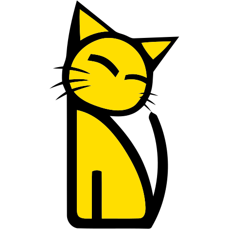

<div align="center">



# Lakutata

An IoC application framework for Node.js and TypeScript

[Website](https://lakutata.com) · [Getting started](https://lakutata.com/guide/GettingStarted) ·
[Examples](https://lakutata.com/examples/) · [API reference](https://lakutata.com/api/) · [中文](README.zh-CN.md)


</div>

Lakutata gives web services, command line tools, desktop (Electron) applications and embedded devices one programming
model. An application is a tree of objects (components, providers, controllers) that a container creates; DTOs validate
the options of the objects and the input of the actions; and transports expose the controllers over HTTP (Express,
Fastify), the command line (Commander), service calls (HTTP, Socket.IO, JSON-RPC 2.0, gRPC, NATS, Electron IPC), MCP,
D-Bus, schedules and message queues. One controller method can serve several of them at once.

## Quick start

```bash
npx @lakutata/cli create --name my-app
cd my-app
npm run dev
# in another terminal
curl 'http://localhost:8080/example?name=you'     # {"message":"Hello, you!"}
```

Lakutata needs Node.js `^22.13.0 || >=24.11.0`. The templates of `lakutata create` give you a web service, a command
line tool, an HTTP API with a React, Vue, Next.js or Nuxt interface, or an Electron application. An application written
by hand looks like this:

```typescript
import {Application, DTO} from 'lakutata'
import {buildEntrypoints, Controller} from 'lakutata/com/entrypoint'
import {GET, ServiceAction} from 'lakutata/decorator/ctrl'
import {Expect} from 'lakutata/decorator/dto'
import {expressHTTPEntrypoint} from 'lakutata/adapter/express'

class GreetDTO extends DTO {
    @Expect(DTO.String().optional().default('world'))
    public name: string
}

class GreetController extends Controller {
    //GET /greet?name=you, and the service action {cmd: 'greet', name: 'you'}
    @GET('/greet', GreetDTO)
    @ServiceAction({cmd: 'greet'}, GreetDTO)
    public async greet(input: GreetDTO): Promise<{ message: string }> {
        return {message: `Hello, ${input.name}!`}
    }
}

Application.run(() => ({
    id: 'com.example.greeter',
    name: 'Greeter',
    components: {
        entrypoint: buildEntrypoints({
            controllers: [GreetController],
            http: expressHTTPEntrypoint({port: 8080})
        })
    },
    bootstrap: ['entrypoint']
}))
```

## Packages

`lakutata` is the framework: it re-exports most of the packages below under its subpaths (`lakutata/com/database`,
`lakutata/adapter/express`…), so an application usually installs it alone, plus the drivers and adapters it uses.

| Package | What it provides | In `lakutata` |
|---|---|---|
| [`lakutata`](packages/lakutata) | The framework, with the `log` and `entrypoint` components preset | |
| [`@lakutata/core`](packages/core) | Applications, objects, dependency injection, DTO validation | yes |
| [`@lakutata/entrypoint`](packages/entrypoint) | Controllers and their transports: HTTP, command line, service calls, schedules | yes |
| [`@lakutata/logger`](packages/logger) | The logger (JSON lines compatible with pino) | yes |
| [`@lakutata/utils`](packages/utils) | `Time` and helper functions | yes |
| [`@lakutata/orm`](packages/orm) | Databases on TypeORM, an embedded MongoDB, migrations | yes |
| [`@lakutata/cache`](packages/cache) | A cache over memory, files, Redis, Memcache, MongoDB, SQLite, PostgreSQL or MySQL | yes |
| [`@lakutata/mutex`](packages/mutex) | Locks shared between processes and instances | yes |
| [`@lakutata/queue`](packages/queue) | Message queues over memory, Redis, NATS, RabbitMQ or Kafka | yes |
| [`@lakutata/i18n`](packages/i18n) | Messages in several languages (ICU MessageFormat) | yes |
| [`@lakutata/security`](packages/security) | Password hashing, signatures, encryption | yes |
| [`@lakutata/monitor`](packages/monitor) | CPU, memory, event loop and HTTP request monitors | yes |
| [`@lakutata/docker`](packages/docker) | Docker images, containers and networks | yes |
| [`@lakutata/containerd`](packages/containerd) | containerd without Docker, for embedded Linux devices | yes |
| [`@lakutata/nats`](packages/nats) | NATS messaging and service calls over NATS | no |
| [`@lakutata/grpc`](packages/grpc) | A gRPC client and server, and service calls over gRPC | no |
| [`@lakutata/dbus`](packages/dbus) | D-Bus services and clients | no |
| [`@lakutata/mcp`](packages/mcp) | The tools, resources and prompts of the Model Context Protocol | no |
| [`@lakutata/cli`](packages/cli) | The `lakutata` command: projects, workspaces, migrations, packaging | no |
| [`@lakutata/builder`](packages/builder) | Bundles, executables and installers, used by `lakutata package` | no |

The templates of `lakutata create` are the `@lakutata/template-*` packages, listed by `@lakutata/templates`.

## Documentation

- [lakutata.com](https://lakutata.com): the guides and the examples, in English and Chinese, and the API reference.
  Their sources are [`packages/lakutata/doc`](packages/lakutata/doc) (`en`, `zh`, and their `examples`) and the type
  declarations of the packages.
- Each package has a README with its options, API and errors.

## Development

```bash
npm install
npm run build        # compiles every package, in the order of their dependencies
npm run test:unit    # the unit tests of the packages
npm run lint         # ESLint, and the check of the documentation of the public API

cd website && npm ci && npm run dev    # the website, once the packages are built
```

The repository holds the packages and the templates (`packages/`), the website (`website/`) and the build and
documentation-check scripts (`scripts/`). [CONTRIBUTING.md](CONTRIBUTING.md) gives the naming rules and how
the public API is documented.

## Lakutata 2.x

Lakutata 3 brought the framework and its packages into this repository. The 2.x releases of `lakutata` are tagged here
(`2.0.x`). The 2.x versions of `@lakutata/cli`, `@lakutata/dbus` and `@lakutata/nats` come from
[lakutata-packages](https://github.com/lakutata/lakutata-packages), and the 2.x templates from the
`lakutata-template-*` repositories.

## License

[MIT](LICENSE)
